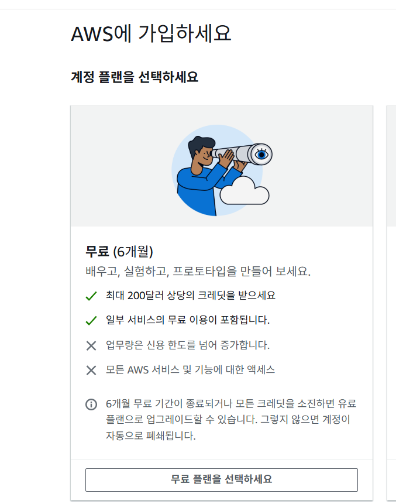
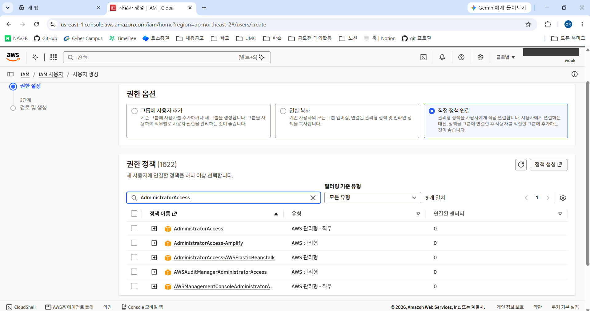
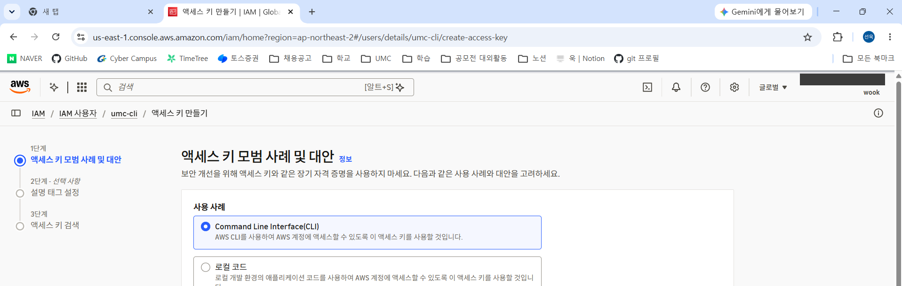

# 0주차 캡처 체크리스트

AWS 콘솔에서 계정 준비 과정. 계정 ID는 가렸다.

| 파일 이름 | 무엇을 찍나 | 상태 |
|---|---|---|
| `01-aws-signup-free-plan.png` | 가입 화면에서 무료 플랜 선택 | ✅ |
| `02-console-region-sydney.png` | 콘솔 첫 화면 (기본 리전이 시드니였음 → 서울로 변경) | ✅ |
| `03-iam-user-policy.png` | IAM 사용자 `umc-cli` 생성, 권한 정책 선택 | ✅ |
| `04-iam-user-created.png` | 사용자 생성 완료, 보안 자격 증명 탭 | ✅ |
| `05-iam-access-key-cli.png` | 액세스 키 만들기, 사용 사례 CLI | ✅ |
| `06-iam-access-key-created.png` | 액세스 키 발급 완료 (비밀 키는 표시하지 않음) | ✅ |

## 미리보기

### 무료 플랜 선택

### IAM 사용자 권한

### CLI용 액세스 키

