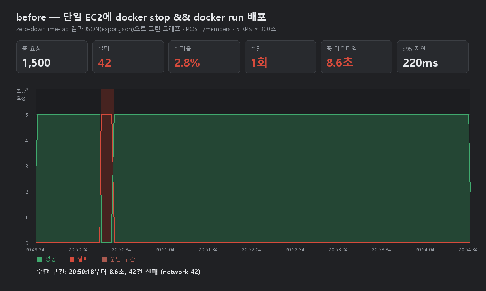
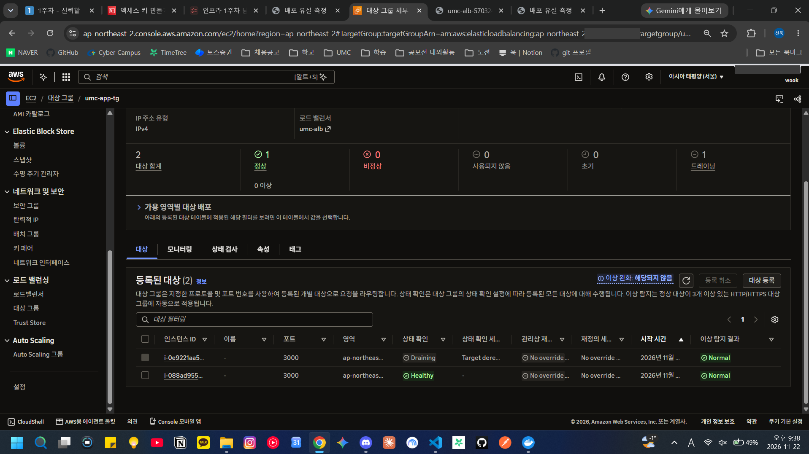
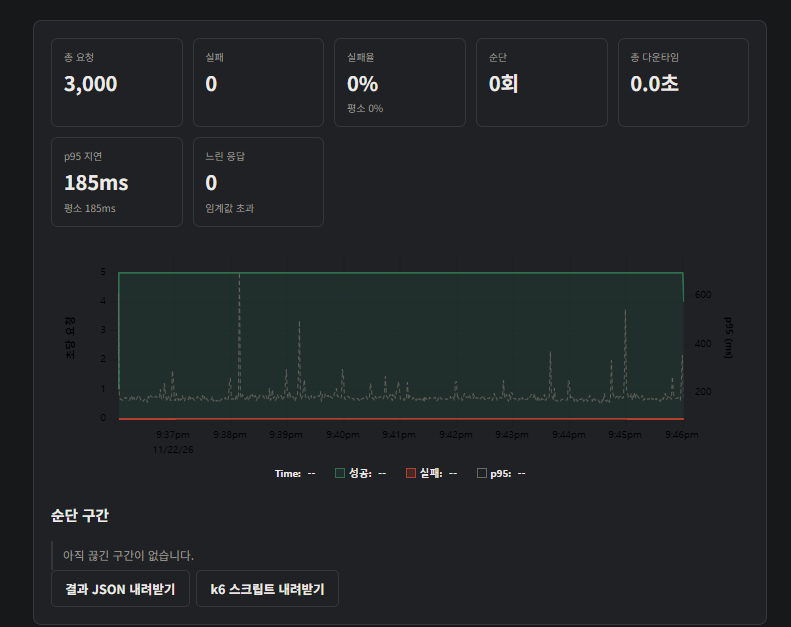
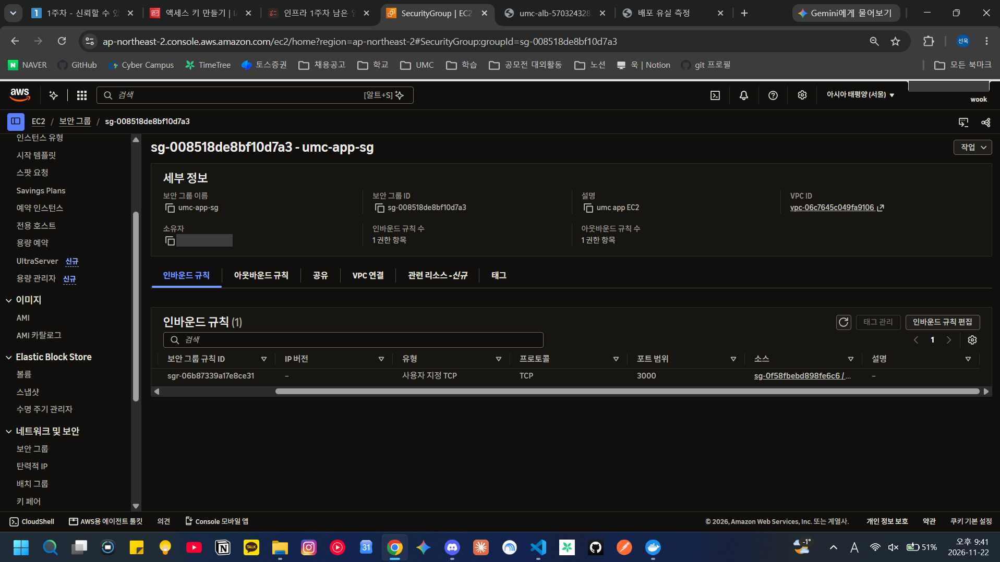
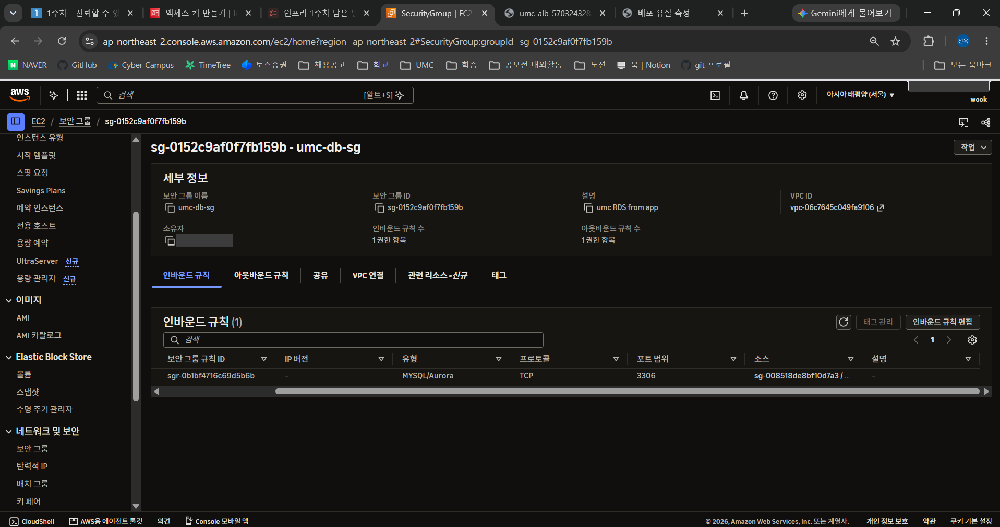

# 1주차 캡처 체크리스트

AWS 콘솔(서울 리전)과 zero-downtime-lab(`localhost:9376`) 화면. 계정 ID는 가렸다. 리소스는 실습 후 모두 삭제했다.

| 파일 이름 | 무엇을 찍나 | 상태 |
|---|---|---|
| `01-before-result-chart.png` | **before** 측정 결과 (측정 도구에서 내보낸 결과 JSON으로 그린 그래프) — 순단 1회, 8.6초 | ✅ |
| `02-ecr-repository.png` | ECR 리포지토리 `umc-app` | ✅ |
| `03-rds-database.png` | RDS `umc-db` 사용 가능 (db.t4g.micro) | ✅ |
| `04-sg-alb.png` | `umc-alb-sg` 인바운드 80/443 ← 0.0.0.0/0 | ✅ |
| `05-sg-db.png` | `umc-db-sg` 인바운드 3306 ← `umc-app-sg` | ✅ |
| `06-sg-app.png` | `umc-app-sg` 인바운드 3000 ← `umc-alb-sg` | ✅ |
| `07-ssm-parameters.png` | Parameter Store `/umc/app/*` 6개 (SecureString 2개) | ✅ |
| `08-iam-role-permissions.png` | IAM 역할 `umc-app-instance` 권한 정책 3개 | ✅ |
| `09-launch-template.png` | 시작 템플릿 `umc-app-lt` | ✅ |
| `10-alb-active.png` | 로드 밸런서 `umc-alb` 활성 | ✅ |
| `11-target-group.png` | 타겟 그룹 `umc-app-tg` (HTTP 3000) | ✅ |
| `12-asg.png` | Auto Scaling 그룹 `umc-asg` 2/2 정상 | ✅ |
| `13-ec2-instances.png` | 인스턴스 3대 (before 1 + ASG 2) | ✅ |
| `14-alb-health.png` | 브라우저에서 `http://<ALB>/health` → `{"status":"UP"}` | ✅ |
| `15-tg-draining-mid-deploy.png` | **배포 중** 타겟: Draining 1 / Healthy 1 | ✅ |
| `16-after-during-deploy.png` | after 측정 중 배포 구간 (실패 0) | ✅ |
| `17-tg-targets-healthy.png` | 배포 후 타겟: Healthy 2 | ✅ |
| `18-after-result.png` | **after** 측정 완료 — 3,000건, 실패 0, 순단 0회 | ✅ |

## 미리보기

### before — 단일 EC2 배포 (다운타임 8.6초)

### 배포 중 — 한 대는 Draining, 한 대는 Healthy

### after — ALB 롤링 배포 (다운타임 0초)

### 보안 그룹 체이닝 — 앱은 ALB에서만, DB는 앱에서만

