# 1주차 미션 기록 — 신뢰할 수 있는 배포 파이프라인

> **목표:** 배포 다운타임을 N초에서 0초로 줄이고, 왜 끊겼는지를 프로세스 수준에서 설명한다.
> **결과:** 단일 EC2 배포 다운타임 **8.6초 → ALB 롤링 배포 0초** (실패 42건 → 0건)

---

## 📌 실습 환경

| 항목 | 내용 |
| --- | --- |
| 배포 대상 앱 | Spring Boot 3.5 / Java 21 / MySQL / JWT (UMC 웹 스터디 movie 백엔드) |
| 리전 | 서울 `ap-northeast-2` |
| 인스턴스 | `t4g.micro` (ARM, Graviton) × 2, Amazon Linux 2023 |
| DB | RDS MySQL 8.4 (`db.t4g.micro`, 비공개) |
| 이미지 저장소 | Amazon ECR (`umc-app`) |
| 작업 환경 | Windows 11, Git Bash, AWS CLI v2, Docker Desktop |
| 측정 도구 | [zero-downtime-lab](https://github.com/UMC-11th-Workbook-Infra/zero-downtime-lab) |

### 최종 구성도

```
인터넷 ──80──▶ ALB (umc-alb, umc-alb-sg)
                 │  리스너 HTTP:80 → 타겟 그룹 umc-app-tg (HTTP:3000, /health)
                 ▼
        ┌────────┴────────┐
   EC2 #1 (ASG)      EC2 #2 (ASG)        ← umc-app-sg: 3000은 ALB SG에서만 허용
   docker: app:3000  docker: app:3000      시작 템플릿 umc-app-lt (user-data → swap.sh)
        └────────┬────────┘
                 ▼ 3306 (umc-db-sg: umc-app-sg에서만 허용)
            RDS MySQL (umc-db, 비공개)

   SSM Parameter Store /umc/app/*  ──(IAM 역할 umc-app-instance)──▶ EC2가 부팅/배포 시 읽음
```

---

## 0. 사전 준비 — AWS 계정 · IAM · CLI

### 진행 과정
1. AWS에 신규 가입하고 **무료 플랜**을 선택했다. 크레딧을 다 쓰면 과금되지 않고 사용이 멈추는 구조다.
2. 콘솔 기본 리전이 시드니로 되어 있어서 **서울(`ap-northeast-2`)**로 바꿨다.
3. 루트 계정에 **MFA**를 설정했다.
4. CLI 전용 **IAM 사용자 `umc-cli`**를 만들었다. 콘솔 접근은 주지 않았고 권한은 `AdministratorAccess`다. 이어서 액세스 키를 발급했다.
5. AWS CLI v2를 설치(`winget install Amazon.AWSCLI`)하고 `aws configure`를 실행했다.

### 확인
```bash
$ aws sts get-caller-identity
{ "Arn": "arn:aws:iam::****:user/umc-cli" ... }
```

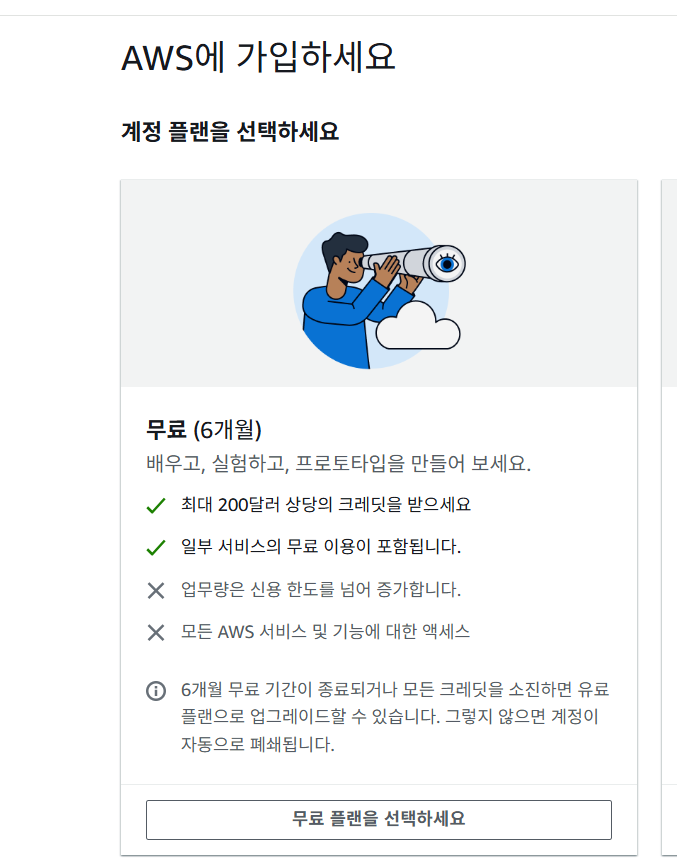
> 무료 플랜 선택
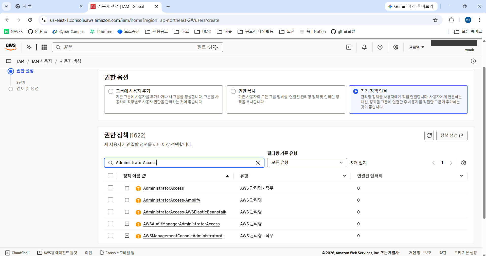
> IAM 사용자 권한 설정
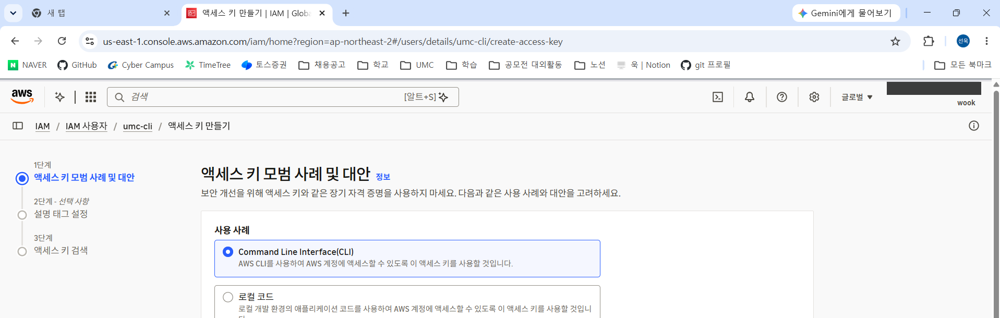
> CLI용 액세스 키 발급

> ⚠️ 오류 → [트러블슈팅 No.1](#-트러블-슈팅) AWS CLI를 설치한 뒤에도 `aws`를 찾지 못함

---

## P. 실습 전제 만들기 — "EC2 한 대에 직접 배포된 상태"

워크북은 Product Engineering 10주차(EC2/RDS 배포)를 마친 상태에서 시작한다. 이 상태를 직접 만들었다.

### P1. 앱을 배포 환경에 맞추기
워크북의 `swap.sh`는 `docker run -e DB_HOST=... -e PORT=3000`처럼 설정값을 주입한다. 앱이 이 값을 읽도록 고쳤다.

**① 설정값을 환경 변수로 분리** (`application.yml`)
```yaml
server:
  port: ${PORT:8080}
spring:
  datasource:
    url: jdbc:mysql://${DB_HOST:localhost}:${DB_PORT:3306}/${DB_NAME:umc_movie}
    username: ${DB_USER:root}
    password: ${DB_PASSWORD}
```
- 원래 `localhost`와 `root`가 코드에 하드코딩되어 있었다. 이러면 서버에서 RDS 주소를 넘겨줘도 무시된다.
- 같은 이미지가 로컬에서도, EC2에서도 돌아야 한다. 환경마다 다른 값은 **실행할 때 주입**한다 (12-Factor의 Config 원칙).

**② `/health` 엔드포인트 추가**
```java
@GetMapping("/health")
public ResponseEntity<Map<String, String>> health() {
    return ResponseEntity.ok(Map.of("status", "UP"));
}
```
- 이 앱은 인터셉터가 모든 경로를 인증한다. ALB 헬스 체크는 토큰 없이 호출되므로 `/health`를 **인증 예외**에 추가했다. 넣지 않으면 401이 나서 ALB가 서버를 unhealthy로 판단한다.

**③ Dockerfile (멀티 스테이지, arm64)**
```dockerfile
FROM --platform=$BUILDPLATFORM eclipse-temurin:21-jdk AS build   # jar는 내 PC(amd64)에서 빌드
...
RUN ./gradlew bootJar -x test --no-daemon && cp build/libs/*-SNAPSHOT.jar /app.jar

FROM eclipse-temurin:21-jre                                        # 실행 이미지는 arm64
COPY --from=build /app.jar /app/app.jar
ENTRYPOINT ["java", "-XX:MaxRAMPercentage=50", "-jar", "/app/app.jar"]
```
- jar는 CPU와 무관한 바이트코드라서, 빌드는 내 PC에서 하고 **실행 이미지만 ARM용**으로 만들면 에뮬레이션이 필요 없다.
- `ENTRYPOINT`를 **exec 형식(JSON 배열)**으로 써서 java가 **PID 1**이 되게 했다. 그래야 `docker stop`의 SIGTERM을 java가 직접 받는다.
- `t4g.micro`의 메모리가 1GB라서 JVM 힙을 50%로 제한했다.

**④ 로컬 검증** — MySQL 컨테이너와 앱을 docker compose로 함께 띄웠다.
```bash
$ docker compose -f compose.local.yml up --build
app-1 | Started MovieApplication in 7.141 seconds
$ curl http://localhost:3000/health
{"status":"UP"}
$ curl http://localhost:3000/members/1/ratings
[{"ratingId":2,"movieId":155,"score":4,...}]      # DB 조회까지 정상
```

### P2. ECR에 이미지 푸시
```bash
$ aws ecr create-repository --repository-name umc-app
$ SHA=$(git rev-parse --short HEAD)               # 08c7c59
$ docker buildx build --platform linux/arm64 --provenance=false -t "${ECR}:${SHA}" --push .
$ docker buildx imagetools inspect "${ECR}:08c7c59"   # → "arm64" "linux"
```
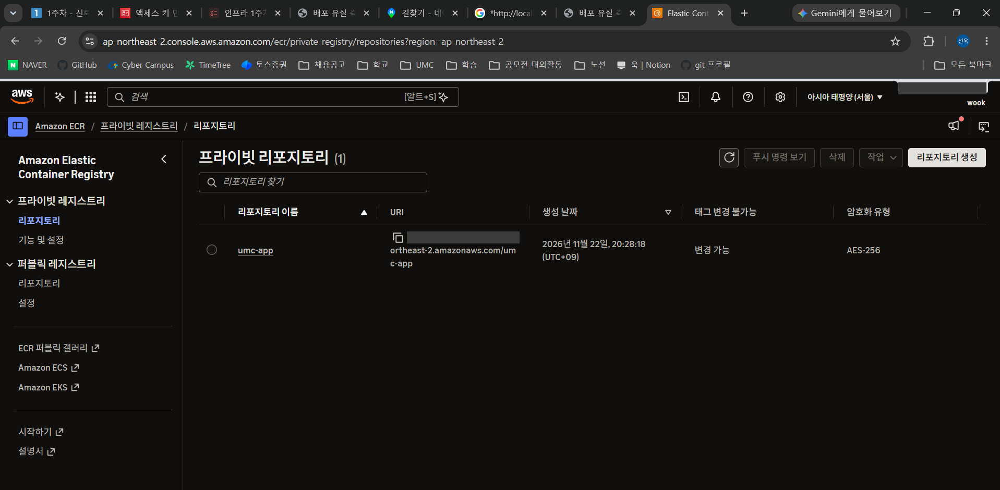

### P3. RDS MySQL과 보안 그룹
```bash
# 앱 EC2용 SG (before 상태: 3000을 인터넷에 직접 오픈)
umc-app-sg : 3000 ← 0.0.0.0/0
# DB용 SG: 앱 SG에서 오는 3306만 허용
umc-db-sg  : 3306 ← umc-app-sg

$ aws rds create-db-instance --db-instance-identifier umc-db --engine mysql \
    --db-instance-class db.t4g.micro --allocated-storage 20 --storage-type gp3 \
    --master-username admin --vpc-security-group-ids "$DB_SG" \
    --no-publicly-accessible --backup-retention-period 0 --no-multi-az ...
creating   8.4.11
```
- RDS는 **퍼블릭 액세스를 끄고**, 앱 서버의 보안 그룹에서만 접근할 수 있게 했다 (SG 체이닝).

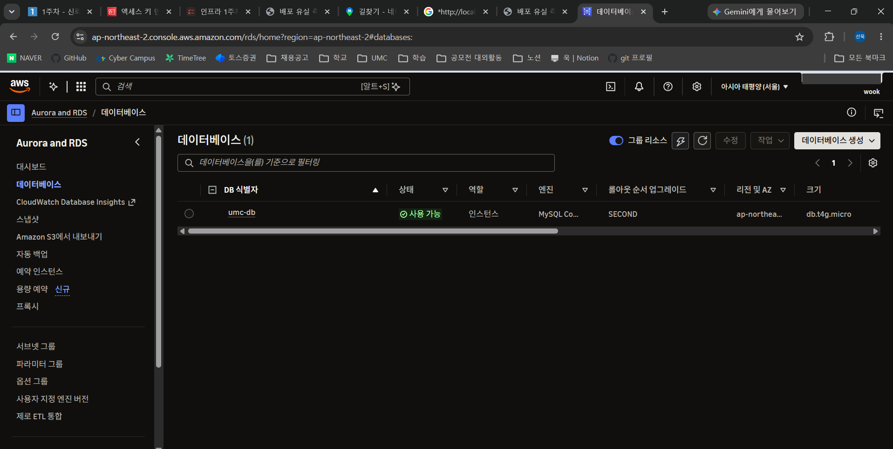
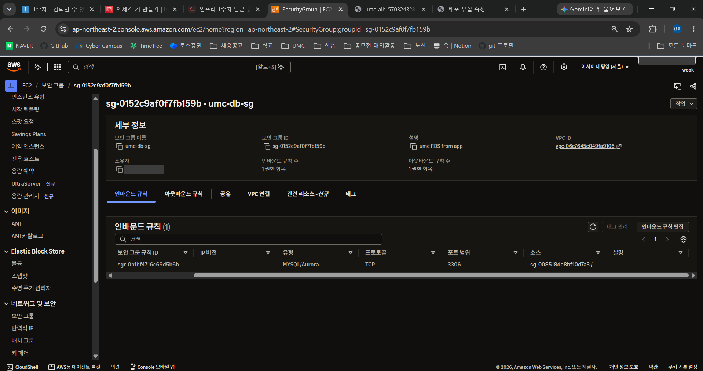

### P4. 단일 EC2 배포 (before 상태)
1. **워크북 3.4.2의 IAM 역할(`umc-app-instance`)을 먼저 만들었다.** before EC2도 ECR에서 이미지를 받아야 하기 때문이다.
2. EC2(`t4g.micro`, AL2023 arm64)를 띄우고, user-data로 Docker를 설치하고 재배포 스크립트를 만들었다.
3. SSM Run Command로 `.env` 작성, RDS에 스키마와 seed 적용, 첫 배포를 진행했다.
```bash
# 재배포 스크립트 (= "기존에 하던 방식")
docker pull "$IMAGE"
docker stop app; docker rm app
docker run -d --name app --restart unless-stopped -p 3000:3000 --env-file /opt/umc/.env "$IMAGE"
```
```bash
$ curl http://<EC2 퍼블릭 IP>:3000/health
{"status":"UP"}
```
> ⚠️ 오류 → [트러블슈팅 No.3](#-트러블-슈팅) `--user-data file://`이 한글 주석 때문에 실패

---

## 1. 지금 배포는 몇 초 멈추는가 — before 측정

### 측정 조건
| 항목 | 값 |
| --- | --- |
| 대상 | `POST /members` (회원가입) — 실제 DB 쓰기까지 포함 |
| 요청 바디 | `{"email":"lab-{{uuid}}@test.local","password":"Test1234!","nickname":"r{{random}}"}` |
| 부하 | **5 RPS × 300초**, 타임아웃 5초, 베이스라인 30초 |
| 배포 | 측정을 시작하고 약 40초 뒤 재배포 1회 (`docker stop && docker run`) |

### 결과
| 총 요청 | 실패 | 실패율 | 순단 | 다운타임 | p95 |
| --- | --- | --- | --- | --- | --- |
| 1,500 | **42 (전부 network)** | 2.8% | 1회 | **8,599ms** | 220ms |

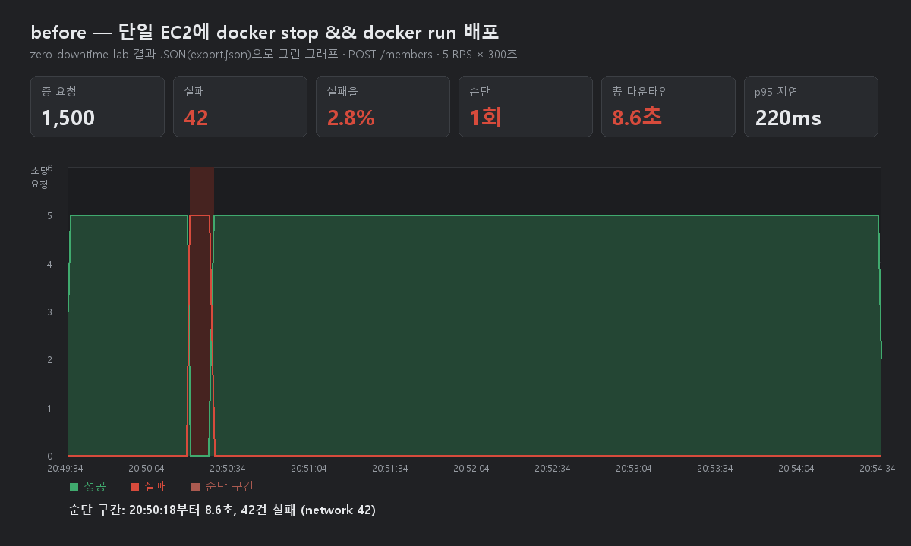
> 측정 도구에서 내보낸 결과 JSON으로 그린 그래프

### 왜 끊겼나 (프로세스 수준)
1. `docker stop`을 실행하면 컨테이너 안의 java(PID 1)가 종료된다.
2. 3000 포트를 잡고 있던 프로세스가 사라지면, 커널은 그 포트로 들어오는 연결에 **TCP RST**를 보낸다. 클라이언트는 즉시 `Connection refused`를 받는다 → 실패 유형이 전부 **`network`**인 이유다.
3. 새 컨테이너가 뜨고 Spring이 기동을 마칠 때까지(약 7초 이상) **요청을 받을 프로세스가 없다** → 순단 8.6초.

> ⚠️ 측정 과정의 오류 → [트러블슈팅 No.4](#-트러블-슈팅) 20 RPS에서 서버가 포화됨 / 닉네임 중복 409

---

## 2. 무중단 배포 구성 — ALB + Auto Scaling 그룹

### 3.2 ALB용 보안 그룹
- `umc-alb-sg`: 80, 443 ← 0.0.0.0/0
- `umc-app-sg`: 3000의 소스를 **ALB SG로 바꾸고**, 기존 0.0.0.0/0 규칙은 **제거**했다.
```bash
$ aws ec2 describe-security-groups --group-ids "$APP_SG" --query 'SecurityGroups[0].IpPermissions'
FromPort 3000 / UserIdGroupPairs: sg-0f58fbebd898fe6c6 (umc-alb-sg)
```
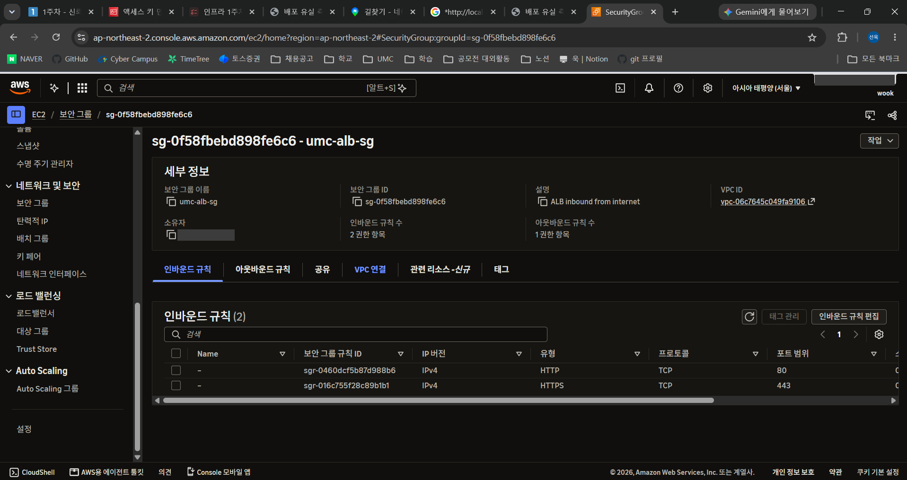
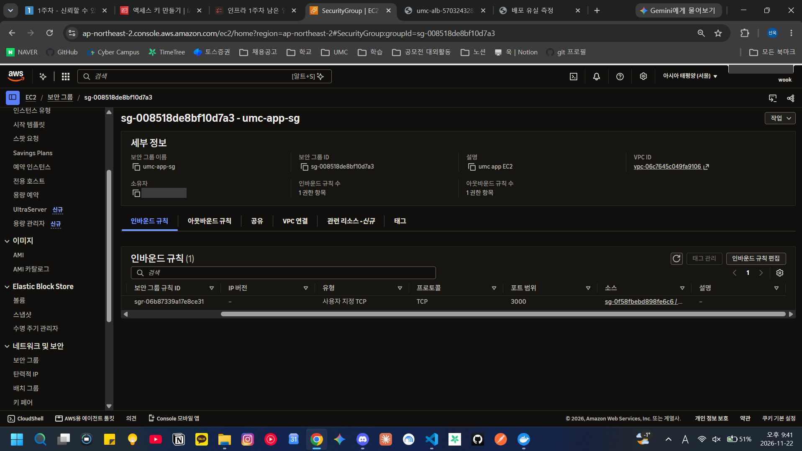

**의미:** 이제 앱 서버는 ALB를 거쳐서만 접근할 수 있다. 인터넷 → ALB → 앱 → DB 순서로만 열려 있다.

### 3.3 SSM Parameter Store
| 파라미터 | 타입 | 값 |
| --- | --- | --- |
| `/umc/app/image` | String | `<ECR>/umc-app:08c7c59` |
| `/umc/app/db-host` | String | RDS 엔드포인트 |
| `/umc/app/db-user` | String | `admin` |
| `/umc/app/db-name` | String | `umc_movie` ※ 워크북 예시는 `movie_db`, 내 앱의 스키마에 맞춰 변경 |
| `/umc/app/db-password` | **SecureString** | (암호화) |
| `/umc/app/jwt-secret` | **SecureString** | (암호화) |
```bash
$ aws ssm get-parameters-by-path --path /umc/app --query 'length(Parameters)'
6
```
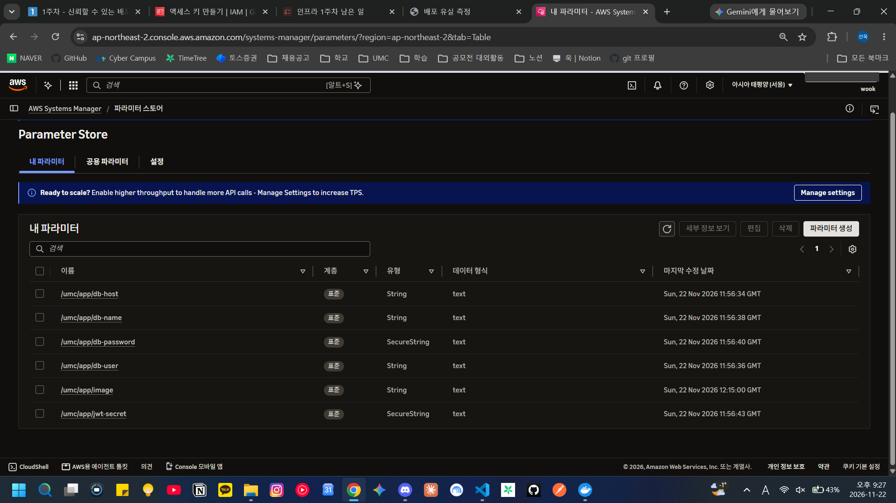

**의미:** 비밀값을 이미지나 코드에 넣지 않고, 인스턴스가 **부팅하거나 배포할 때 읽어 온다.** 이미지를 바꿔도 비밀값은 그대로 유지된다.

### 3.4 IAM 역할 · user-data · 시작 템플릿
| 정책 | 이유 |
| --- | --- |
| `AmazonEC2ContainerRegistryReadOnly` | ECR에서 이미지 pull |
| `AmazonSSMManagedInstanceCore` | Session Manager / Run Command |
| 인라인 `umc-ssm-params` | `/umc/app/*` 읽기 + SecureString 복호화(`kms:Decrypt`) |

- user-data가 `/opt/umc/swap.sh`를 만들고 부팅할 때 한 번 실행한다. `swap.sh`는 SSM에서 값을 읽어 컨테이너를 띄운다.
- 시작 템플릿 `umc-app-lt`: AL2023 arm64, `t4g.micro`, `umc-app-instance`, 공인 IP
- 시작 템플릿에 들어간 user-data를 다시 꺼내 원본 `userdata.sh`와 비교해 **바이트 단위로 같은지** 확인했다.

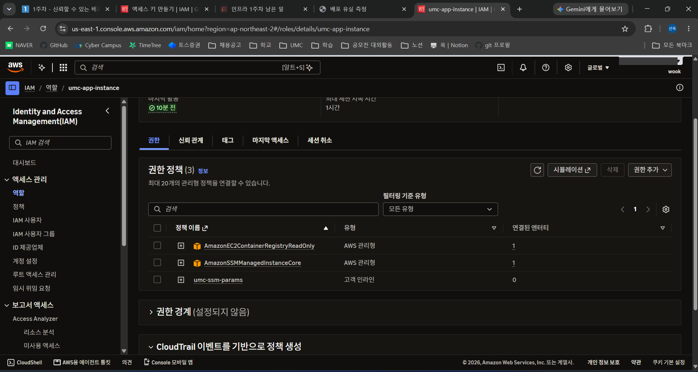
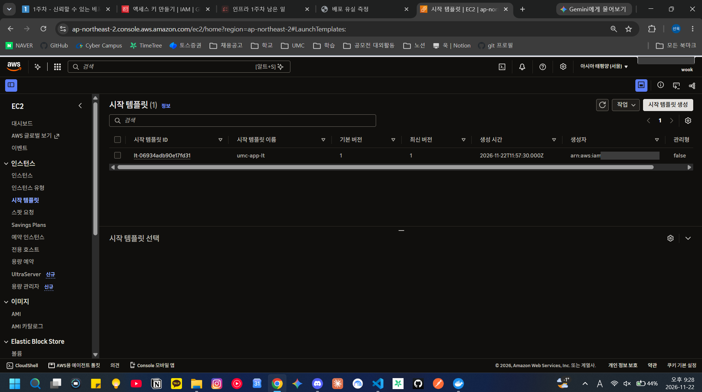

### 3.5 타겟 그룹 · ALB · 리스너
| 설정 | 값 | 의미 |
| --- | --- | --- |
| 타겟 그룹 | HTTP 3000, `/health` | ALB가 10초마다 `/health`를 호출 |
| 정상/비정상 임계값 | 2 / 2 | 2번 연속 성공하면 투입, 2번 연속 실패하면 제외 |
| **deregistration_delay** | **30초** (기본 300초) | 빠지는 서버가 처리 중인 요청을 마칠 시간 |
| ALB | internet-facing, 서브넷 2a, 2b, 2c | `umc-alb-xxxx.ap-northeast-2.elb.amazonaws.com` |
| 리스너 | HTTP 80 → umc-app-tg | |

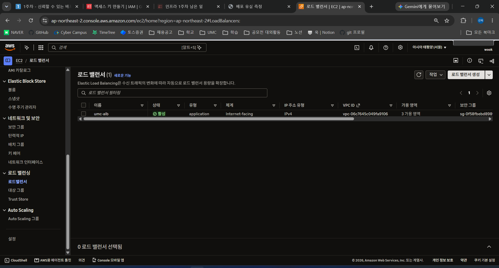
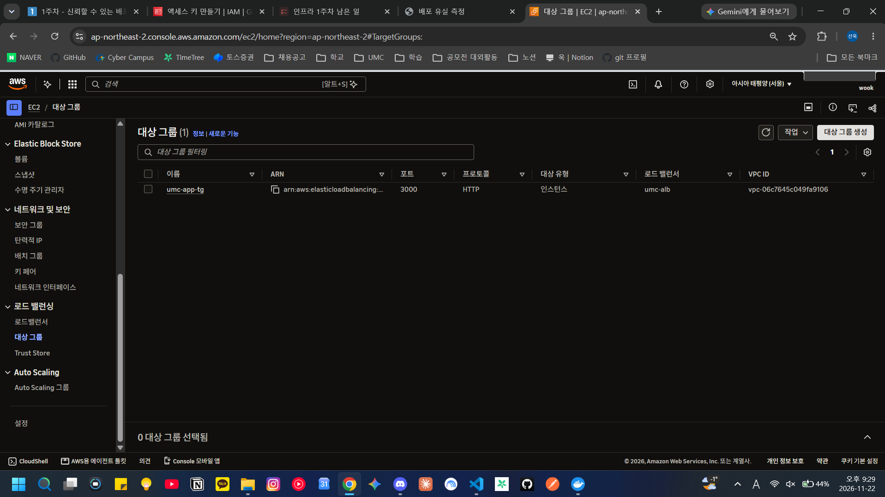

### 3.6 Auto Scaling 그룹
- `umc-asg`: 최소 2, 원하는 용량 2, 최대 4, 헬스 체크 EC2, grace 180초
- 생성 후 **약 5분 뒤 타겟 2개가 healthy**가 됐다. 그동안 인스턴스가 부팅하고, user-data로 Docker를 설치하고, 이미지를 pull하고, Spring이 기동했다.
```bash
$ curl http://<ALB DNS>/health
{"status":"UP"}
```
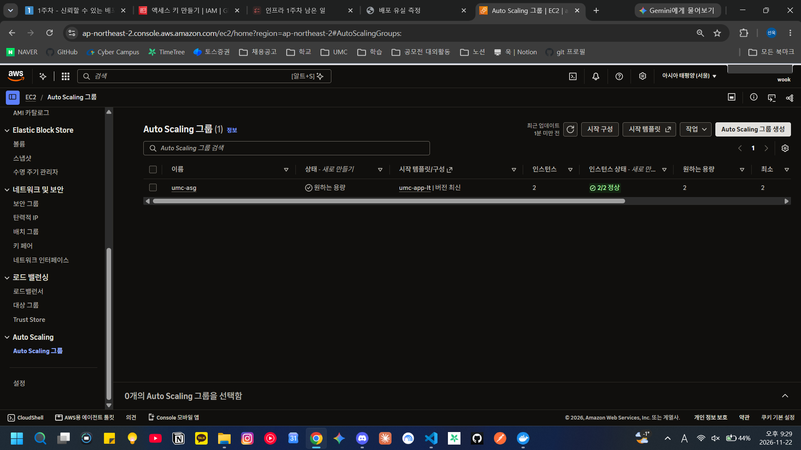
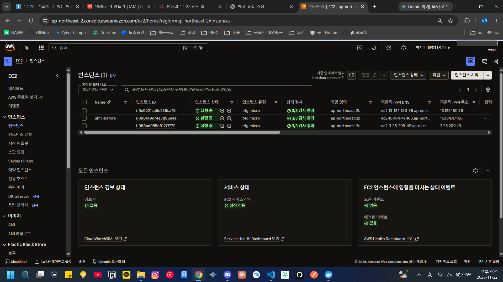
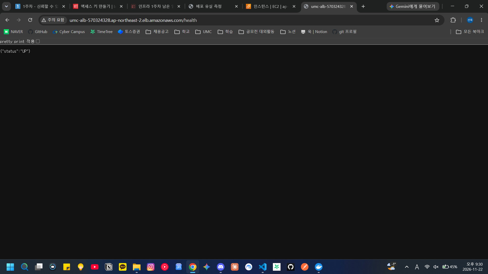
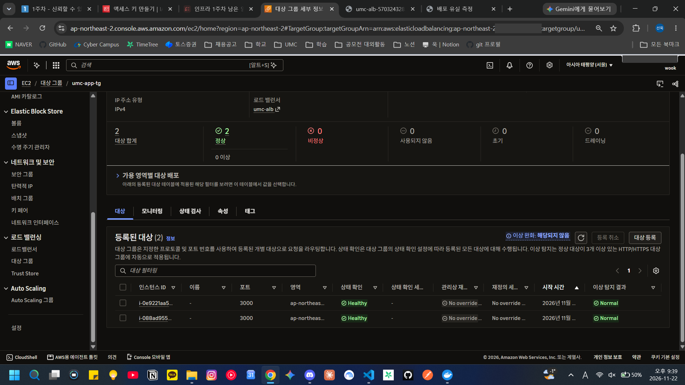

---

## 3. 무중단 배포 — `deploy.sh` (3.7)

워크북의 `deploy.sh`를 **그대로** 실행했다. 동작 흐름은 이렇다.
1. arm64 이미지를 빌드해 ECR에 푸시한다 (`<ECR>:<git SHA>`).
2. SSM의 `/umc/app/image`를 갱신한다 (앞으로 새로 뜨는 인스턴스가 읽을 태그).
3. InService 인스턴스를 **한 대씩** 처리한다.
   - `deregister-targets` → **`wait target-deregistered`** (드레이닝 30초)
   - SSM Run Command로 `swap.sh` 실행 → 컨테이너 교체 (실패하면 즉시 중단)
   - `register-targets` → **`wait target-in-service`** (헬스 체크 통과까지 대기)

### 배포 중 타겟 그룹 상태 (6초 간격 조회)
```
21:14:51  A:healthy   B:healthy
21:15:06  A:healthy   B:draining    ← B deregister, 처리 중 요청을 기다림
21:15:36  A:healthy                 ← B 빠짐, 컨테이너 교체
21:15:51  A:healthy   B:initial     ← B register, 헬스 체크 중
21:15:59  A:healthy   B:healthy
21:16:06  A:draining  B:healthy     ← B가 정상이 된 뒤에야 A 차례
21:16:37              B:healthy
21:16:52  A:initial   B:healthy
21:17:07  A:healthy   B:healthy     ← 완료 (총 2분 14초)
```
**항상 최소 한 대는 healthy인 상태로 트래픽을 받았다.**

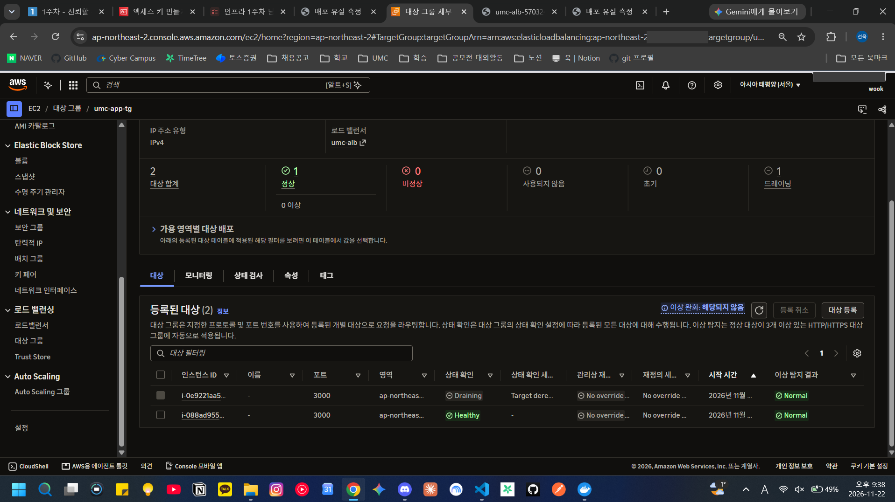
> 배포 중: Draining 1 / Healthy 1

### 무중단을 만드는 2줄
```bash
aws elbv2 wait target-deregistered   # 빠지는 서버의 처리 중 요청이 끝날 때까지
aws elbv2 wait target-in-service     # 새 컨테이너가 정상이 될 때까지
```
- 첫 줄이 없으면: 처리 중이던 요청이 있는 컨테이너를 바로 죽여서 그 요청들이 실패한다.
- 둘째 줄이 없으면: 새 컨테이너가 아직 기동 중인데 다음 서버를 빼서 **두 대 모두 응답하지 못하는 순간**이 생긴다.

---

## 4. 검증 — after 측정

### 측정 조건
before와 같다(`POST /members`, 5 RPS, 타임아웃 5초, 베이스라인 30초). 대상만 **ALB 주소**로 바꿨고, **측정 길이는 600초**로 늘렸다. 롤링 배포(빌드 + 2대 교체)가 300초 안에 다 들어오지 않을 수 있어서다.

### 결과
after는 **두 번** 측정했고, 두 번 모두 실패가 0이었다. 1차는 측정 도구 API로 실행했고, 2차는 결과 화면을 캡처하려고 같은 조건으로 다시 측정했다.

| 회차 | 배포 시각 | 총 요청 | 실패 | 실패율 | 순단 | 다운타임 | p95 |
| --- | --- | --- | --- | --- | --- | --- | --- |
| 1차 | 21:14:50 ~ 21:17:04 | 3,000 | **0** | **0%** | **0회** | **0ms** | 184ms |
| 2차 | 21:37:06 ~ 약 21:39 | 3,000 | **0** | **0%** | **0회** | **0ms** | 185ms |

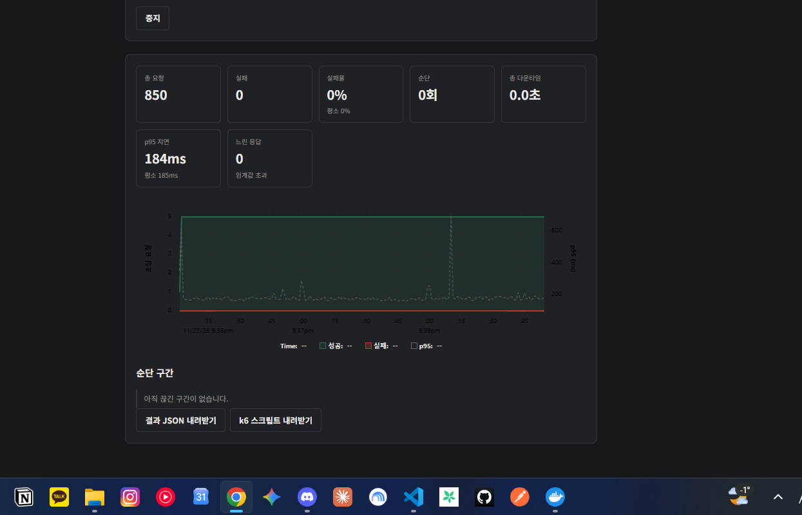
> 2차 측정 중 배포가 진행되는 동안의 화면 (850건 시점, 실패 0)
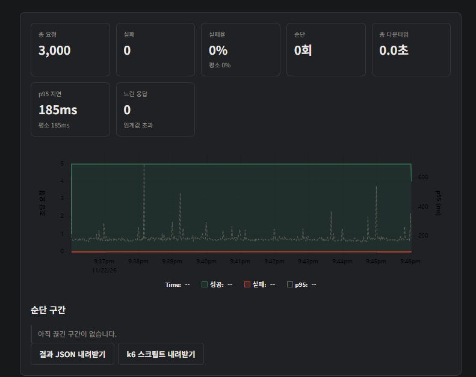
> 2차 측정 완료 화면 (3,000건, 순단 0회, "아직 끊긴 구간이 없습니다")

---

## 5. 롤백을 위한 이미지 태깅 전략 (3.8)

`latest` 하나만 쓰면 "어느 시점의 이미지인지" 알 수 없고, 롤백하려면 빌드부터 다시 해야 한다. 그래서 **`version-yy-mm-dd-N`** 정책을 적용했다.

1. 배포 중인 이미지에 **`v1.0.0-26-11-22-1`** 태그를 붙였다. 다시 빌드하지 않고 같은 매니페스트에 태그만 추가했다. (`put-image`)
2. SSM `/umc/app/image`를 버전 태그로 바꿨다 → 앞으로 새로 뜨는 인스턴스는 버전이 명시된 이미지를 쓴다.
3. ECR 수명 주기 정책을 설정했다 (워크북 권장값).

```bash
$ aws ecr describe-images --repository-name umc-app --query 'imageDetails[].[imageDigest,imageTags]'
sha256:4dc1edb5...   v1.0.0-26-11-22-1, 08c7c59, 2bbcf39      # 한 이미지, 태그 3개

$ aws ecr get-lifecycle-policy --repository-name umc-app
1 expire untagged images after 7 days
2 keep last 10 tagged images
```

> ⚠️ 오류 → [트러블슈팅 No.6](#-트러블-슈팅) 태그를 붙였는데 digest가 달라짐

**롤백할 때는** `/umc/app/image`를 이전 버전 태그로 되돌리고 `swap.sh`로 한 대씩 교체하면 된다. 빌드는 필요 없다.

---

## 6. 리소스 정리

실습이 끝난 뒤 과금을 막기 위해 의존 관계 순서대로 모두 삭제했다.

```
ASG(인스턴스 2대 종료) → before EC2 종료 → RDS(최종 스냅샷 없음) → 리스너 → ALB → 타겟 그룹
→ 시작 템플릿 → 보안 그룹(db → app → alb, 서로 참조하는 순서의 역순) → ECR 저장소 → SSM 파라미터 6개 → IAM 역할·인스턴스 프로파일
```
```bash
# 삭제 후 서울 리전 확인
EC2 0 · EBS 0 · EIP 0 · ALB 0 · TG 0 · ASG 0 · 시작 템플릿 0 · RDS 0 · RDS 스냅샷 0 · ECR 0 · SSM 0 · SG(기본 제외) 0 · IAM 역할 0
```
- 보안 그룹은 **다른 SG가 참조하고 있으면 지울 수 없다.** `umc-db-sg`가 `umc-app-sg`를, `umc-app-sg`가 `umc-alb-sg`를 참조하므로 db → app → alb 순서로 지웠다.
- 실습 중 화면 캡처로 노출됐던 **IAM 액세스 키를 교체**했다. 새 키를 발급하고 동작을 확인한 뒤 옛 키를 비활성화하고 삭제했다.

---

## ✅ 최종 결과

|  | 단일 배포 | 무중단 배포 |
| --- | --- | --- |
| 대상 | EC2 퍼블릭 IP:3000에 직접 | ALB |
| 배포 | `docker stop && docker run` | `deploy.sh` 롤링 (한 대씩 교체) |
| 측정 길이 | 300초 | 600초 |
| 총 요청 | 1,500 | 3,000 |
| 실패 | **42 (전부 network)** | **0** |
| 실패율 | **2.8%** | **0%** |
| 순단 | **1회** | **0회** |
| 다운타임 | **8,599ms** | **0ms** |
| p95 | 220ms | 184ms |

---

## ⚡ 트러블 슈팅

- ⚡이슈 No.1 — AWS CLI를 설치한 뒤에도 `aws` 명령을 찾지 못함
    
    **`이슈`**
    
    👉 `winget install Amazon.AWSCLI`로 설치에 성공했는데, VS Code 터미널(PowerShell)에서 `aws configure`를 실행하자 `'aws' 용어가 cmdlet, 함수, 스크립트 파일 또는 실행할 수 있는 프로그램 이름으로 인식되지 않습니다. (CommandNotFoundException)` 에러가 났다.
    
    **`문제`**
    
    👉 설치 자체는 정상이었다(`C:\Program Files\Amazon\AWSCLIV2\aws.exe`가 있음). 설치 프로그램은 PATH 환경 변수에 경로를 등록하지만, **이미 실행 중이던 VS Code는 시작할 때 복사해 둔 옛 PATH를 계속 쓴다.** 그래서 VS Code 안에서 터미널을 새로 열어도 `aws`를 찾지 못했다.
    
    **`해결`**
    
    👉 현재 PowerShell 세션의 PATH를 시스템과 사용자 설정에서 다시 읽어 왔다. 근본적으로는 VS Code를 완전히 종료한 뒤 다시 실행하면 된다.
    
    ```powershell
    $env:Path = [Environment]::GetEnvironmentVariable('Path','Machine') + ';' + [Environment]::GetEnvironmentVariable('Path','User')
    aws --version   # aws-cli/2.42.1 ...
    ```
    
    💡 실행 중인 프로세스는 바뀐 환경 변수를 모른다. 재시작해야 반영된다. 컨테이너를 다시 띄워야 새 설정(SSM 값, 환경 변수)이 적용되는 것과 같은 원리다.
    
    **`참고레퍼런스`**
    
    - [AWS CLI 설치 — Windows](https://docs.aws.amazon.com/cli/latest/userguide/getting-started-install.html)
    - [about_Environment_Variables (PowerShell)](https://learn.microsoft.com/powershell/module/microsoft.powershell.core/about/about_environment_variables)
- ⚡이슈 No.2 — Git Bash에서 `/`로 시작하는 AWS 인자가 Windows 경로로 바뀜
    
    **`이슈`**
    
    👉 Git Bash에서 `aws ssm get-parameter --name /aws/service/ami-amazon-linux-latest/al2023-ami-kernel-default-arm64`가 `ParameterNotFound`로 실패했다.
    
    액세스 키를 교체할 때도 같은 문제가 다시 생겼다. `aws configure set aws_secret_access_key <값>`으로 저장한 뒤 인증이 `SignatureDoesNotMatch`로 실패했다.
    
    **`문제`**
    
    👉 Git Bash(MSYS)는 Windows 프로그램(`aws.exe`)에 넘기는 인자 중 **`/`로 시작하는 값**을 리눅스 경로로 보고 `C:/Program Files/Git/...`로 **자동 변환**한다.
    
    - `/aws/service/...` → `C:/Program Files/Git/aws/service/...` → 그런 파라미터는 없음
    - 새 비밀 키가 마침 `/`로 시작해서 앞에 `C:/Program Files/Git`(20자)이 붙은 채 저장됨
    
    워크북의 SSM 파라미터 이름(`/umc/app/*`)이 전부 이 형태라서, 그대로 실행하면 다 깨진다.
    
    **`해결`**
    
    👉 경로 변환을 끄고 실행했다. 저장된 비밀 키는 앞에 붙은 접두어 20자를 떼어 내 복구했다.
    
    ```bash
    export MSYS_NO_PATHCONV=1
    ```
    
    반대로 이 설정을 켜면, Windows 프로그램(curl, python, `aws ... file://`)에 `/c/Dev/...` 형식의 파일 경로가 통하지 않는다. 이때는 `C:/Dev/...` 형식을 썼다.
    
    💡 같은 명령이라도 셸에 따라 인자가 달라진다. 워크북은 리눅스/macOS 기준이다. Windows Git Bash에서 AWS CLI를 쓸 때는 `MSYS_NO_PATHCONV=1`을 **항상** 켜 둔다.
    
    **`참고레퍼런스`**
    
    - [MSYS2 — Filesystem Paths (자동 경로 변환)](https://www.msys2.org/docs/filesystem-paths/)
- ⚡이슈 No.3 — `--user-data file://`로 한글 주석이 든 스크립트를 넘기면 실패
    
    **`이슈`**
    
    👉 before용 EC2를 만들 때 `aws ec2 run-instances ... --user-data file://p4-userdata.sh`를 실행하자 다음 에러가 났다.
    
    ```
    Error parsing parameter '--user-data': Unable to load paramfile (p4-userdata.sh), text contents could not be decoded.
    ```
    
    **`문제`**
    
    👉 Windows용 AWS CLI는 `file://`로 읽는 파일을 **시스템 기본 인코딩(CP949)**으로 해석한다. 스크립트의 한글 주석은 UTF-8이라서 해석에 실패했다.
    
    **`해결`**
    
    👉 `fileb://`(바이트 그대로)로 넘겼다. user-data는 CLI가 알아서 base64로 인코딩한다. ECR 수명 주기 정책처럼 `fileb://`를 받지 않는 옵션은 JSON을 ASCII(영문)로만 작성해 `file://`로 넘겼다.
    
    ```bash
    aws ec2 run-instances ... --user-data fileb://p4-userdata.sh
    ```
    
    💡 `file://`은 텍스트(인코딩 해석 필요), `fileb://`은 바이트 그대로다. 워크북 3.4.3은 user-data를 직접 `base64`로 바꿔 JSON에 넣기 때문에 이 문제가 없다.
    
    **`참고레퍼런스`**
    
    - [AWS CLI — Loading parameters from a file](https://docs.aws.amazon.com/cli/latest/userguide/cli-usage-parameters-file.html)
- ⚡이슈 No.4 — before 측정이 배포 전부터 실패함 (측정 조건 문제)
    
    **`이슈`**
    
    👉 ① 회원가입 API를 20 RPS로 측정하자 **배포하기 전 구간(베이스라인)의 실패율이 37%**였고 timeout이 2,908건 나왔다.
    
    👉 ② RPS를 낮춰 다시 측정하자 이번에는 실패가 전부 **4xx(client)**였다.
    
    **`문제`**
    
    👉 ① 회원가입은 비밀번호를 **BCrypt로 해시**해서 요청당 CPU를 약 0.13초 쓴다. 20 RPS면 매초 CPU 2.6초어치의 일이 쌓이는데 `t4g.micro`는 vCPU가 2개라 **포화**됐다. 포화 상태에서는 배포가 미친 영향을 구분할 수 없다.
    
    👉 ② 닉네임을 `u{{counter}}`로 보냈는데, 측정을 시작할 때마다 `u1, u2...`부터 다시 시작해서 이전 측정에서 가입된 닉네임과 겹쳤다 → **409(중복)**.
    
    **`해결`**
    
    👉 ① 같은 API를 유지하고 **5 RPS**로 낮췄다 (CPU 약 0.65초/초).
    
    👉 ② 닉네임을 `r{{random}}`(측정마다 고유)으로 바꿨다. 측정 도구 README의 조언대로 **한 건을 손으로 먼저 보내** 201이 나오는지 확인한 뒤 측정했다.
    
    → 베이스라인 실패율 0%에서 다시 측정해 유효한 결과를 얻었다 (다운타임 8,599ms).
    
    💡 "배포 중 끊김"을 재려면 **평소 상태가 먼저 안정적이어야 한다.** 실패 유형을 보면 원인이 보인다. `network`는 붙을 곳이 없음(배포 중), `timeout`은 느림이나 포화, `client`(4xx)는 요청 자체가 틀린 경우다.
    
    **`참고레퍼런스`**
    
    - [zero-downtime-lab README — 실패 유형 해석, 치환자](https://github.com/UMC-11th-Workbook-Infra/zero-downtime-lab)
- ⚡이슈 No.5 — PowerShell에서 Git Bash 경로를 써서 `cd` 실패
    
    **`이슈`**
    
    👉 `cd /c/Dev/umc-infra-study`를 실행하자 `'C:\c\Dev\umc-infra-study' 경로는 존재하지 않으므로 찾을 수 없습니다.` 에러가 났고, 그 뒤 `docker compose -f compose.local.yml up`도 파일을 찾지 못했다.
    
    **`문제`**
    
    👉 `/c/...`는 Git Bash의 경로 표기다. PowerShell은 `C:\...` 형식을 쓰기 때문에 `/c/Dev`를 `C:\c\Dev`로 해석했다.
    
    **`해결`**
    
    👉 워크북 스크립트가 bash 문법(`export`, `$(...)`, 배열)이라서 이후 모든 명령을 **Git Bash**에서 실행했다. VS Code 기본 터미널도 Git Bash로 바꿨다 (`Ctrl+Shift+P` → `Terminal: Select Default Profile` → Git Bash).
    
    **`참고레퍼런스`**
    
    - [VS Code — Terminal Profiles](https://code.visualstudio.com/docs/terminal/profiles)
- ⚡이슈 No.6 — 이미지에 태그만 추가했는데 digest가 달라짐
    
    **`이슈`**
    
    👉 3.8에서 배포 중인 이미지에 `v1.0.0-26-11-22-1` 태그를 추가하려고, `batch-get-image`로 매니페스트를 받아 `put-image`를 실행했다. 그런데 원래 이미지(`sha256:4dc1ed...`)가 아니라 **새 digest(`sha256:9971c3...`)**로 등록됐다.
    
    **`문제`**
    
    👉 `--output text`로 매니페스트를 꺼내면서 **공백과 줄바꿈이 바뀌었다.** digest는 매니페스트 **바이트의 해시값**이라서 한 글자만 달라도 다른 이미지가 된다.
    
    **`해결`**
    
    👉 잘못 붙은 태그를 삭제하고, 매니페스트를 JSON으로 받아 **바이트 그대로** 파일에 저장한 뒤 다시 `put-image`를 실행했다 → 원래 digest(`4dc1ed...`)에 태그가 붙었다.
    
    ```bash
    aws ecr batch-get-image --repository-name umc-app --image-ids imageTag=2bbcf39 --output json > img.json
    # imageManifest 값을 그대로 manifest.json 으로 저장
    aws ecr put-image --repository-name umc-app --image-tag v1.0.0-26-11-22-1 \
      --image-manifest file://manifest.json --image-manifest-media-type <원본 mediaType>
    ```
    
    💡 컨테이너 이미지의 정체성은 태그가 아니라 **digest(콘텐츠 해시)**다. 태그는 digest를 가리키는 이름표라서 한 이미지에 여러 개를 붙일 수 있다.
    
    **`참고레퍼런스`**
    
    - [Amazon ECR — 이미지 리태깅](https://docs.aws.amazon.com/AmazonECR/latest/userguide/image-retag.html)

> 💡 **(Notion용) 토글로 바꾸는 법:** 붙여넣으면 `⚡이슈 No.N` 줄이 글머리 기호로 들어온다. 이슈 6개를 드래그로 모두 선택하고 왼쪽 `⋮⋮` 핸들 → **전환 → 토글 목록**을 누르면, 안쪽 내용이 그대로 토글 안에 들어간다.

---

## 🎯 핵심 키워드 정리

> 아래는 초안이다. 내 말로 다시 다듬는다.

- **무중단 배포**: 새 버전으로 바꾸는 동안에도 사용자 요청이 실패하지 않게 하는 배포. 핵심은 "요청을 받을 프로세스가 항상 하나 이상 살아 있게" 하는 것이다.
- **ALB (Application Load Balancer)**: L7 로드 밸런서. 요청을 타겟에 나누고, 헬스 체크로 죽은 타겟을 자동으로 빼고, API(`register`/`deregister`)로 타겟을 조작할 수 있다.
- **타겟 그룹 draining (`deregistration_delay`)**: 등록 해제된 타겟에 새 요청을 보내지 않으면서, 처리 중인 요청은 설정한 시간 동안 끝날 때까지 기다리는 상태. 너무 짧으면 처리 중 요청이 잘리고, 너무 길면 배포가 느려진다.
- **SSM Parameter Store**: 설정값과 비밀값을 중앙에 저장하는 서비스. SecureString은 KMS로 암호화된다. 이미지와 코드에 비밀값을 넣지 않고 실행할 때 주입한다.
- **Rolling Update**: 인스턴스를 한 대(또는 몇 대)씩 순서대로 교체한다. 추가 자원이 거의 들지 않지만, 교체 중에는 구버전과 신버전이 동시에 트래픽을 받는다.

---

## 📢 학습 후기

처음 보는 용어도 많고 Windows 환경에서 예상하지 못한 곳에서 자주 막혀서 솔직히 어려웠다. 그래도 직접 해 보면서 조금씩 알아갈 수 있었다. 단일 EC2에서 배포하자 8.6초 동안 요청이 끊기는 것을 숫자로 확인했고, ALB 타겟 그룹에서 한 대가 Draining인 동안 다른 한 대가 트래픽을 받는 모습을 보고 나서야 무중단 배포가 어떻게 동작하는지 이해됐다. 결국 실패 0건, 다운타임 0초를 만들었을 때 뿌듯했다. 아직 Auto Scaling이나 Graceful shutdown은 완벽하게 이해하지 못해서, 다음 주차를 진행하면서 더 공부해 보려고 한다.
